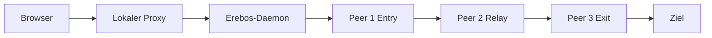
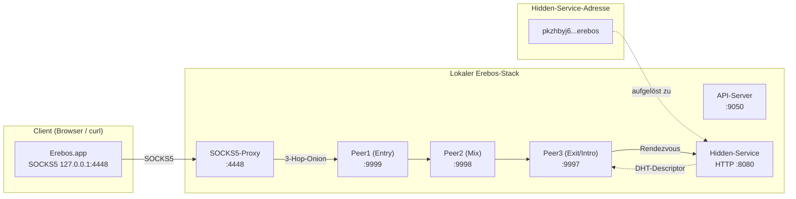
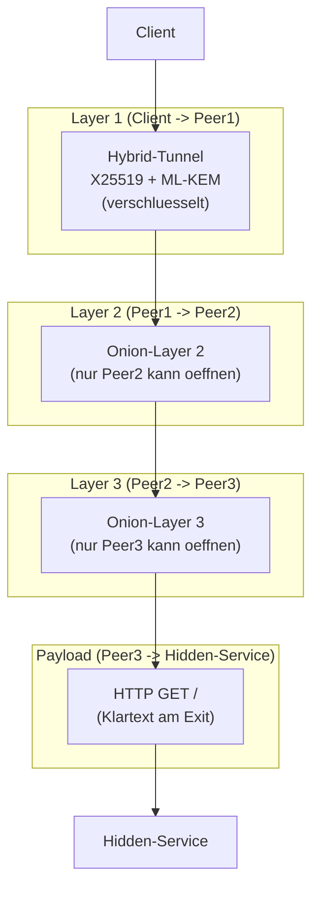
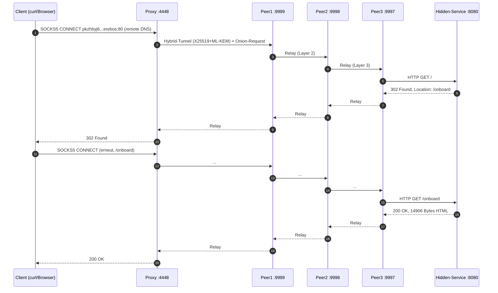

# Erebos — Architektur

## Überblick
Erebos ist ein 3-Hop-Onion-Netzwerk mit Post-Quantum-Kryptographie.


## Netzwerk-Topologie (Detail)



**Ports im Überblick:**

| Port | Dienst | Zweck |
|------|--------|-------|
| 9050 | API-Server | Status, Peer-Liste, Hidden-Service-Registry |
| 4448 | SOCKS5-Proxy | Einstiegspunkt für Client-Anfragen |
| 9999 | Peer1 (Entry) | Erster Hop, baut Hybrid-Tunnel zum Client |
| 9998 | Peer2 (Mix) | Mittlerer Hop, leitet Relay-Frames weiter |
| 9997 | Peer3 (Exit/Intro) | Exit-Hop, entschlüsselt Onion-Layer, spricht HTTP |
| 8080 | Hidden-Service | HTTP-Server, liefert die `.erebos`-Seite |

## Verschlüsselungs-Schichten



**Eigenschaften:**

- **Transport:** Jeder Hop baut einen eigenen **Hybrid-Tunnel** (X25519 + ML-KEM-768)
  auf. Der Handshake ist im Log sichtbar (`version=0x02, x_pub=32B,
  mlkem_pub=1568B, sig=64B`).
- **Onion:** Jeder Hop entfernt genau eine Schicht. Kein Peer kennt sowohl
  Entry als auch Exit.
- **Exit-Klartext:** Am Exit-Peer (Peer3) ist der HTTP-Request im Klartext
  sichtbar – das ist bei Onion-Routing so gewollt. Der Schutz liegt darin, dass
  **kein einzelner Peer** die gesamte Kette sieht.

## Datenfluss eines `.erebos`-Requests



**Beobachtungen aus dem Smoke-Test:**

- Der erste Request auf `/` liefert **302 Found** mit `Location: /onboard`.
- Der Folge-Request auf `/onboard` liefert **200 OK** mit ~14.900 Bytes HTML.
- Der Hidden-Service setzt ein Session-Cookie (`forum_client_id=...`).
- Für `127.0.0.1` wird der PoW-Schutz **übersprungen** (Localhost-Ausnahme in
  `hidden_service_runtime.py`).

## Smoke-Test

Der Stack lässt sich mit einem reproduzierbaren Test prüfen:

```bash
cd ~/Projects/erebos-network
source .venv/bin/activate
python tests/test_encryption_smoke.py
```

Der Test prüft vier Dinge:

1. **Ports:** 9050, 4448, 9997, 9998, 9999, 8080 lauschen.
2. **HTTP E2E:** SOCKS5 → `.erebos` → 200 OK mit HTML (folgt Redirects).
3. **Localhost-PoW:** Im Hidden-Service-Log steht „Localhost-Client ...
   übersprungen".
4. **Verschlüsselung:** `tcpdump` auf Port 9999 zeigt keinen HTTP-Klartext.

## Bekannte Stolperfallen

- **`UnboundLocalError` in `proxy.py`:** Lokale `from .tunnel import
  ErebosTunnelClient`-Imports entfernen – der Modul-Import (Zeile 15) reicht.
- **`UnboundLocalError` in `tunnel.py`:** Lokalen `from .onion import
  open_layer`-Import entfernen – der Modul-Import (Zeile 34) reicht.
- **PoW-Blockade für localhost:** `hidden_service_runtime.py` nimmt
  `127.0.0.1`/`::1` von der PoW-Prüfung aus.
- **Browser-Proxy:** SOCKS5 (nicht HTTP) auf `127.0.0.1:4448`, mit
  `network.proxy.socks_remote_dns = true`.
