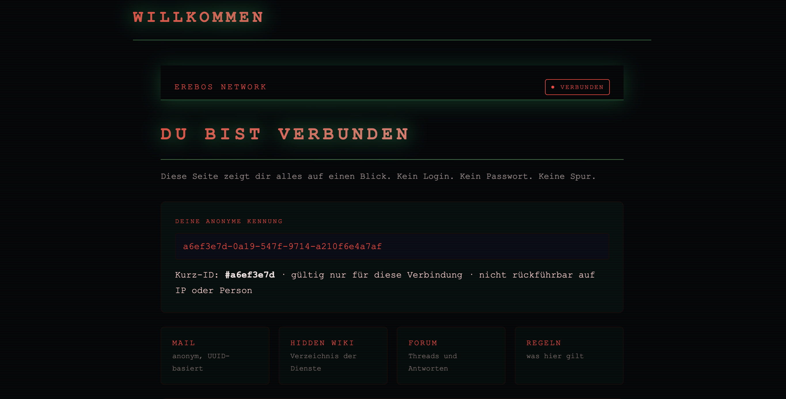
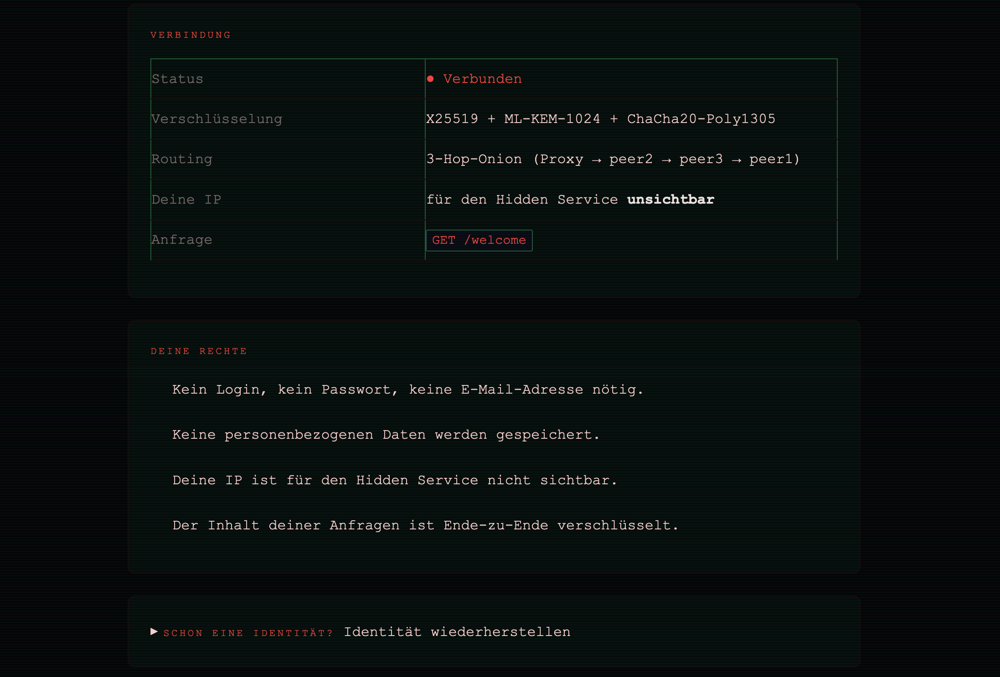
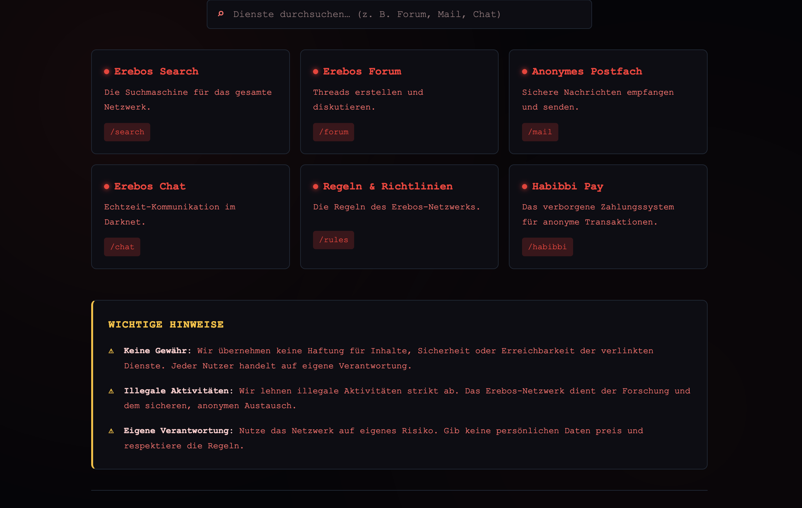
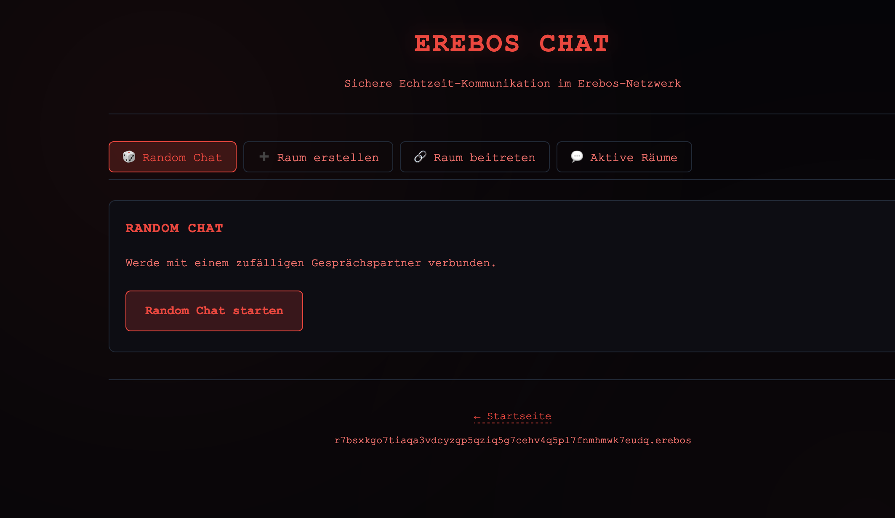
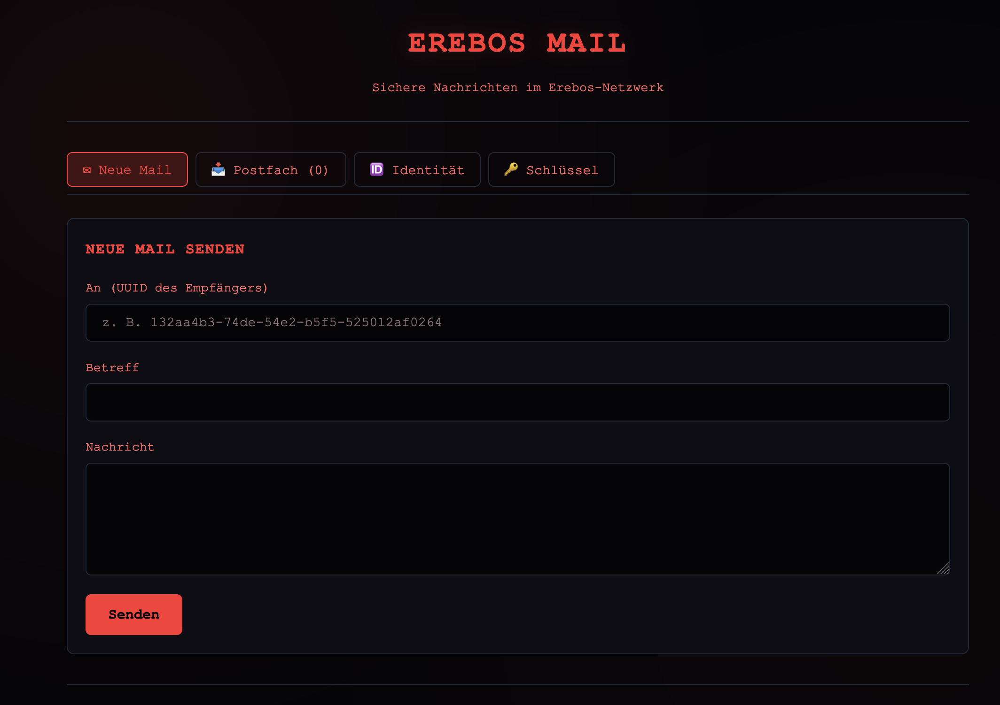
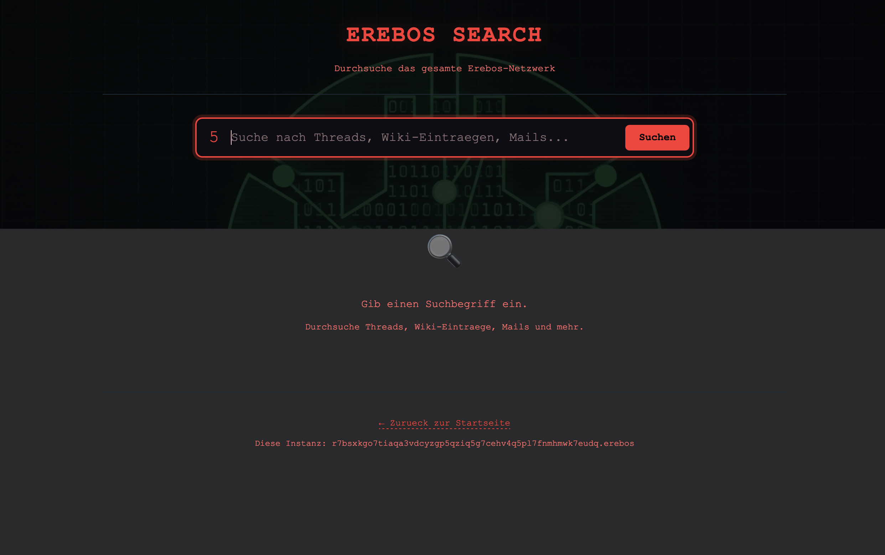
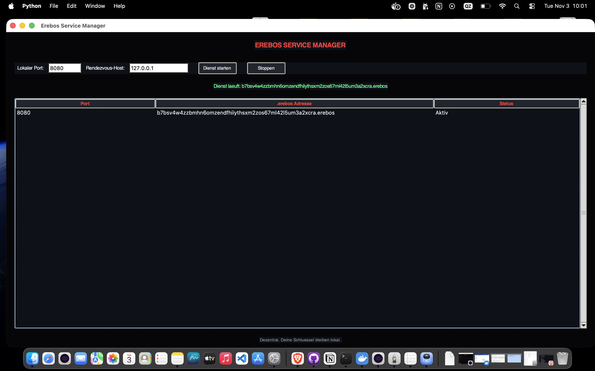

# Erebos — UX-Screenshots

Eine Übersicht der wichtigsten Benutzeroberflächen des Erebos-Browsers.

## Welcome

Die Startseite des Erebos-Browsers mit den wichtigsten Einstiegspunkten.

## Welcome (Alternative Ansicht)

Alternative Startseite mit erweiterten Optionen.

## Wiki

Das dezentrale Wiki — Inhalte werden über das Erebos-Netzwerk verteilt.

## Chat

Der Chat-Bereich mit Ende-zu-Ende-Verschlüsselung.

## Mail

Das Mail-System mit hybridem Schlüsselaustausch (X25519 + ML-KEM).

## Search

Die Suche über dezentrale Inhalte im Erebos-Netzwerk.

## Hidden Service Manager

Verwaltung der eigenen Hidden Services — Start, Stopp und Status.
