# Erebos — Cover-Traffic

## Problem: Timing-Fingerprints
Ohne Cover-Traffic verrät das Timing-Muster die Aktivität.

```mermaid
gantt
    title Traffic ohne Cover
    dateFormat  X
    axisFormat  %s
    section Client
    Request      :a1, 0, 2
    Idle         :a2, 2, 6
    Request      :a3, 6, 8
```

## Lösung: Kalibrierter Cover-Traffic
Der Daemon sendet konstant Padding-Pakete, die von echten nicht unterscheidbar sind.

```mermaid
gantt
    title Traffic mit Cover
    dateFormat  X
    axisFormat  %s
    section Client
    Cover + Request    :b1, 0, 12
```

